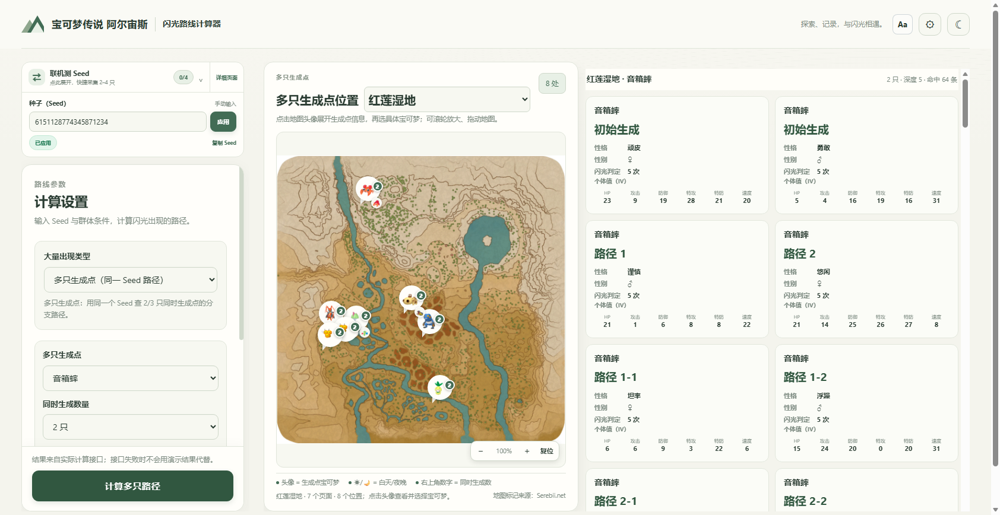
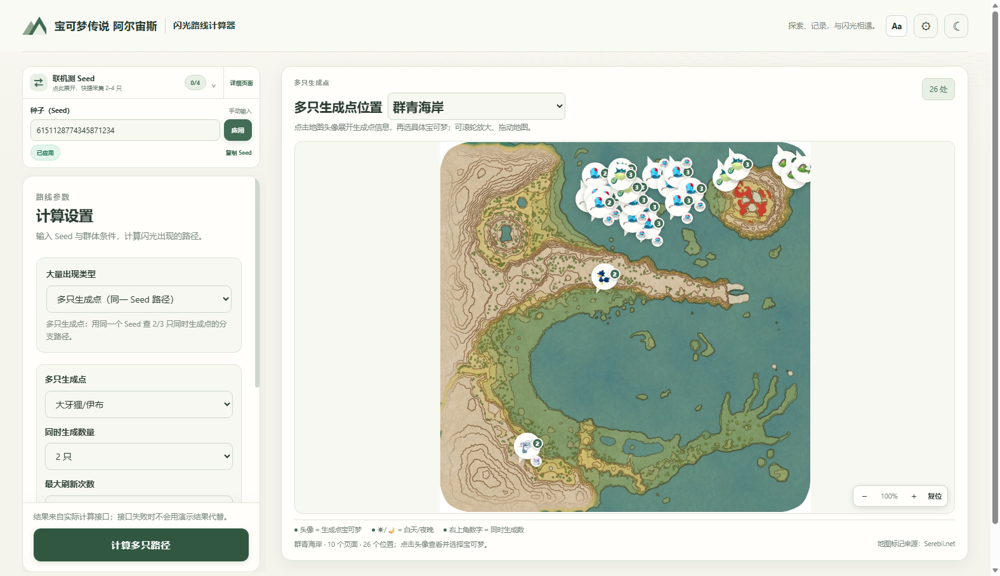
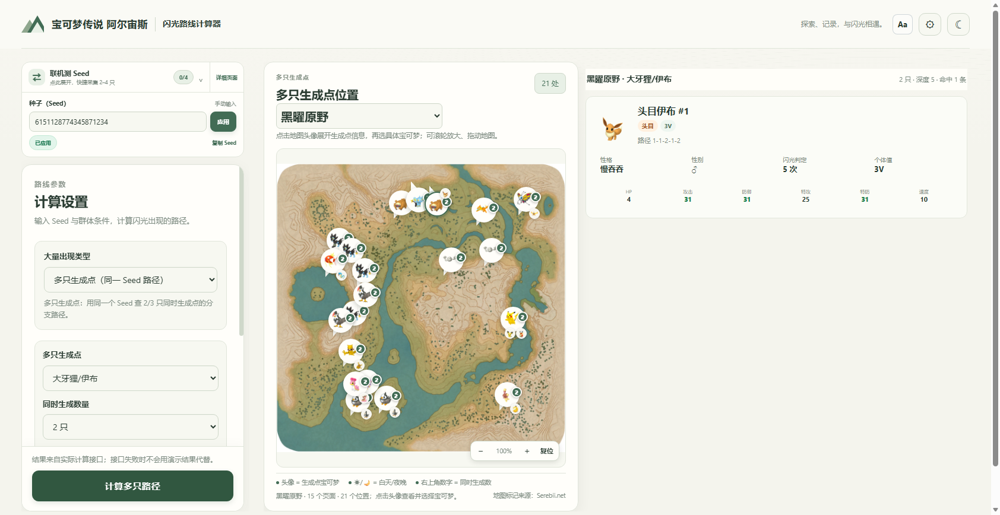

# PLA MMO Seed & Path

《宝可梦传说 阿尔宙斯》MMO **Seed 获取 + 闪光路径计算**工具。

> 本仓库是新的独立项目，不是旧仓库 `PLA-MMO-Path-Finder` 的备份。  
> 旧仓库仅保留测 Seed 相关功能；本项目同时支持联机采集 Seed、地图点位和闪光路径计算。

- 作者：**君粒**
- 当前版本：**v0.9.6**
- 许可证：**GPL v3.0**
- 平台：Windows 10 / 11
- 状态：公开仓库

## 下载

- [Windows 安装版 v0.9.6](https://github.com/Yuutalin/PLA-MMO-Seed-Path/releases/download/v0.9.6/PLA-MMO-Seed-Path-0.9.6-Setup.exe)
- [Windows 便携版 v0.9.6](https://github.com/Yuutalin/PLA-MMO-Seed-Path/releases/download/v0.9.6/PLA-MMO-Seed-Path-0.9.6-portable.zip)
- [Pokeldn 精简运行时](https://github.com/Yuutalin/PLA-MMO-Seed-Path/releases/download/v0.9.6/pokeldn-slim-v0.66.12.zip)
- [SHA256 校验文件](https://github.com/Yuutalin/PLA-MMO-Seed-Path/releases/download/v0.9.6/SHA256SUMS.txt)

安装版按用户安装，不需要管理员权限，安装后从开始菜单或桌面快捷方式启动。

便携版解压后运行：

```text
Start-PLA.bat
```

或双击 `Start-PLA.vbs`（不显示控制台窗口）。

程序使用自带的 Python + 原生 WebView2 窗口启动，**不使用 Edge App，也不会打开浏览器地址栏**。  
建议解压到较短的路径（例如 `D:\PLA-MMO-Seed-Path`），避免 Windows 旧式路径长度限制影响 WebView2 初始化。

## 功能

- 联机采集 2–4 只最初捕获宝可梦，并反推 MMO 群体 Seed
- 本地 RNG 路径计算，不上传 Seed 或存档
- 五地区地图与多只生成点位置
- 支持 2 只 / 3 只同时生成
- 支持多只生成点路径，路径深度 5 / 9 / 12 / 16
- 闪光、头目、方块闪组合筛选
- 结果卡显示性格、性别、闪光判定、个体值和路径概要
- ESP32-S3 无线板检测与固件烧录
- 多主题、浅色 / 深色模式
- 应用内检查更新、下载安装包、手动选择本地更新包
- 卸载时可选择清理缓存、日志、设置和更新包

## 更新与卸载

从 v0.9.6 开始，设置 →「更新」可以检查 GitHub 最新版本、查看更新日志并下载更新包。

- 安装版会下载 Setup，确认后退出并静默安装，完成后自动重新打开。
- 便携版会下载 portable ZIP，在原目录替换程序文件，保留 `cache`、地图标注和自定义图片。
- 网络下载失败时，可以打开 Release 页面手动下载，再在「手动更新包」中选择 ZIP 或 Setup；程序会检查包结构，ZIP 还会检查版本和可选的 SHA256。
- 第一次从 v0.9.5 升级到 v0.9.6 需要手动安装一次；v0.9.5 没有更新中心。
- 安装版的卸载程序会列出缓存、日志、设置和更新包，可勾选是否一起删除。程序内「设置 → 更新」下方也有清理入口。
- 更新不会包含 `prod.keys`、用户存档、日志或 `cache` 中的资源。

## 界面







## 运行源码

要求：

- Windows 10 / 11
- Python 3.13（与打包运行时一致）
- Microsoft Edge WebView2 Runtime

```powershell
python -m pip install -r requirements.txt
python app.py
```

也可以双击项目根目录的 `启动.vbs`。

## 一键编译

需要：

- Python 3.13
- Inno Setup 6（仅生成安装包时需要）

双击：

```text
一键编译.bat
```

输出在 `release`：

```text
PLA-MMO-Seed-Path-0.9.6-Setup.exe
PLA-MMO-Seed-Path-0.9.6-portable.zip
update.json
SHA256SUMS.txt
```

如果只想要便携版：

```powershell
powershell -ExecutionPolicy Bypass -File build\build_python_release.ps1 -PortableOnly
```

编译脚本会：

- 复制应用源码；
- 复制 Python 3.13 运行时及必要依赖；
- 生成便携 ZIP（内含 `python\pythonw.exe`）；
- 生成按用户安装的 Setup（快捷方式直接启动 `pythonw.exe app.py`）；
- 生成 `update.json` 更新清单；
- 生成 SHA256 校验文件。

编译产物不包含 `cache`、`prod.keys`、用户设置或日志；不使用 PyInstaller，也不使用 Edge App 启动器。

## 联机运行时

联机采集需要 Pokeldn 精简源码运行时，不随源码仓库分发。

当前资源地址：

```text
https://github.com/Yuutalin/PLA-MMO-Seed-Path/releases/download/v0.9.6/pokeldn-slim-v0.66.12.zip
```

下载后在程序「设置 → 资源管理」中自动安装，或手动解压到：

```text
cache/pokeldn-slim/
```

`prod.keys` 必须由用户从自己的 Switch 导入，仓库和发行包都不包含。

## 使用到的开源项目

| 项目 | 用途 | 许可证 |
|---|---|---|
| [Decryptu/pokeldn](https://github.com/Decryptu/pokeldn) | 联机运行时 / LDN | AGPL-3.0 |
| [kwsch/EtumrepMMO](https://github.com/kwsch/EtumrepMMO) | 四只 PA8 反推群体 Seed | 上游许可证 |
| [Lincoln-LM/JS-Finder](https://github.com/Lincoln-LM/JS-Finder) | 地图点位数据参考 | GPL-3.0 |
| [Serebii Pokéarth](https://www.serebii.net/pokearth/hisui/) | 地图底图参考 | 版权归 Serebii |

详细第三方说明见 `LICENSES.md`。

## 公开与分发说明

- 本仓库为公开项目；
- 不包含 `prod.keys`、用户存档、日志或个人数据；
- 不包含 PokeIdn 完整发行包；
- 宝可梦名称、图像和相关商标归各自权利人所有；
- 本项目为非官方工具，与 Nintendo / The Pokémon Company / GAME FREAK / Creatures Inc. 无隶属或认可关系。

## 致谢

- Pokeldn 上游作者
- EtumrepMMO 上游作者
- 地图与点位数据来源
- 所有参与测试和反馈的用户
